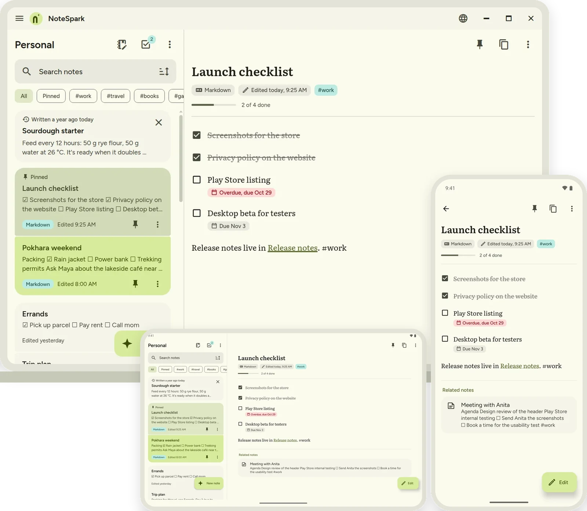

<div align="center">


# NoteSpark

**Private notes that stay on your devices.**<br />
No account. No cloud. No ads. No tracking.

<a href="https://notespark.lusansapkota.com.np/#get"></a>
<a href="https://notespark.lusansapkota.com.np/#watch-title"></a>
<a href="https://notespark.lusansapkota.com.np"></a>

<sub>
<a href="https://github.com/Lusan-sapkota/NoteSpark/releases/latest"></a>

<a href="./LICENSE"></a>
</sub>

<br />

<picture>
  <source media="(prefers-color-scheme: dark)" srcset="./web/assets/hero-dark.webp" />
  
</picture>

</div>

<br />

## Why you'll like it

|  |  |
|---|---|
| **Write your way**<br />Plain text or Markdown, version history, a scratchpad. | **Tasks in your notes**<br />Type `- [ ] call Sam due:2026-11-01`. Every open task lands on one screen. |
| **Find by meaning**<br />Search understands what a note is about, on your device. | **Locked profiles**<br />PIN-protected and encrypted. No analytics, no update checks. |
| **Never trapped**<br />Export Markdown, back up to a folder, restore from a file. | **Sync, if you want it**<br />Between your own devices, on your own network only. |

## Get it

**Android, Windows, macOS and Linux.** Downloads, stores and install commands are on the **[website](https://notespark.lusansapkota.com.np/#get)**. Every [release](https://github.com/Lusan-sapkota/NoteSpark/releases/latest) ships a `SHA256SUMS` file.

## Build from source

The phone app is [`mobile/`](./mobile) (Expo, React Native, Material 3), the desktop app is [`desktop/`](./desktop) (Electron), shared code is in [`packages/`](./packages), and the website is [`web/`](./web) (plain HTML and CSS).

```bash
cd mobile && npm install
npx expo run:android          # needs the Android SDK; native modules mean no Expo Go
npx tsc --noEmit              # type check

cd ../desktop && npm install && npm run build
npx electron .                # unset ELECTRON_RUN_AS_NODE if your editor sets it

cd ../packages/core && npm test
```

---

<div align="center">
<sub>
<a href="https://notespark.lusansapkota.com.np/help.html">Help</a> ·
<a href="https://notespark.lusansapkota.com.np/changelog.html">Changelog</a> ·
<a href="https://notespark.lusansapkota.com.np/privacy.html">Privacy</a> ·
<a href="./LICENSE">GPLv3</a><br />
Made by <a href="https://github.com/Lusan-sapkota">Lusan Sapkota</a> · <a href="mailto:contact@lusansapkota.com.np">contact@lusansapkota.com.np</a>
</sub>
</div>
