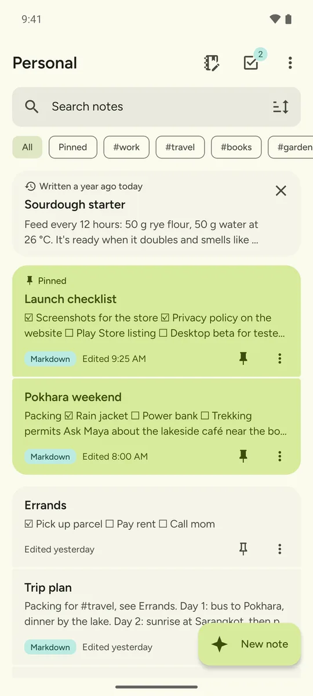
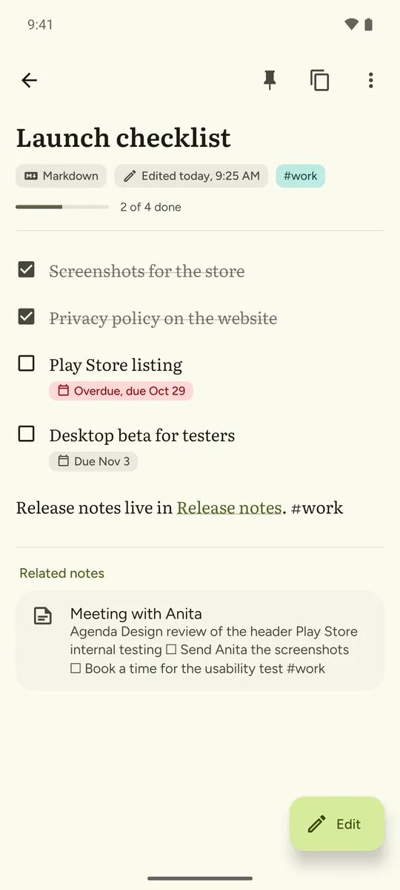
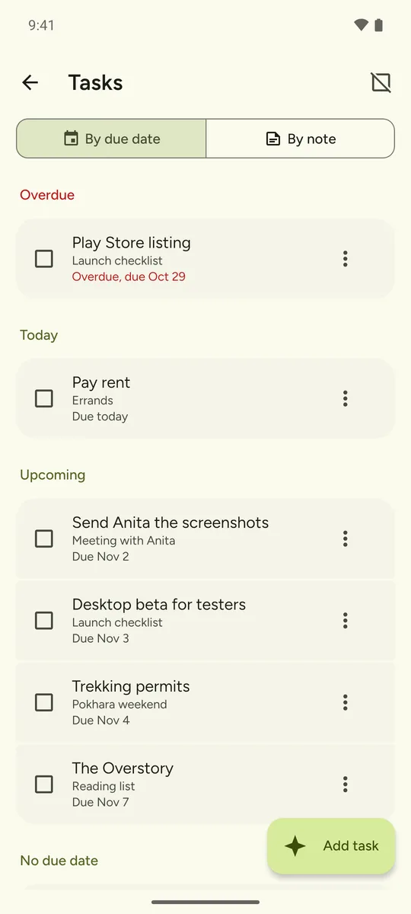
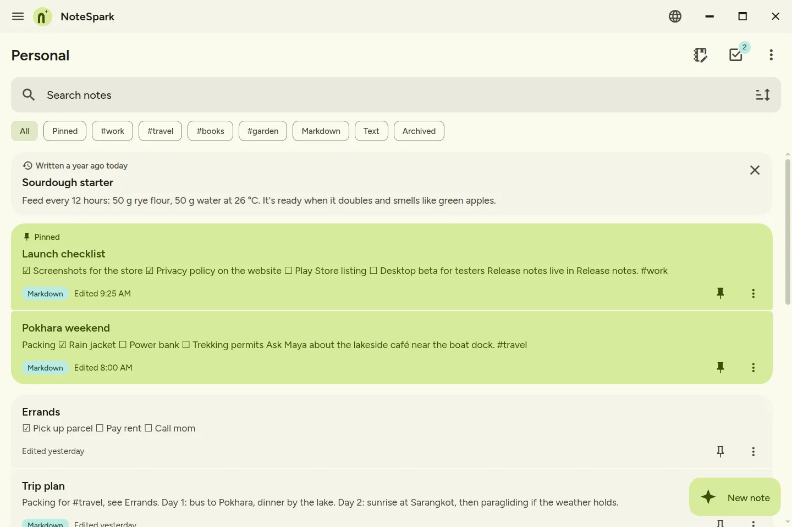

<div align="center">
  
</div>

# NoteSpark

Private notes that stay on your devices. No account, no cloud, no ads, no tracking.

Write in plain text or Markdown, keep tasks inside your notes, and find a note by what it means, not just by its words. NoteSpark works fully offline. If you want your phone and computer in step, sync is optional and nothing leaves your own network.

<p align="center">
  <picture>
    <source media="(prefers-color-scheme: dark)" srcset="./web/assets/screens/home-dark.webp" />
    
  </picture>
  <picture>
    <source media="(prefers-color-scheme: dark)" srcset="./web/assets/screens/note-dark.webp" />
    
  </picture>
  <picture>
    <source media="(prefers-color-scheme: dark)" srcset="./web/assets/screens/tasks-dark.webp" />
    
  </picture>
</p>

<p align="center">
  <picture>
    <source media="(prefers-color-scheme: dark)" srcset="./web/assets/screens/desktop-home-dark.webp" />
    
  </picture>
</p>

There is an 80-second [demo video](./web/assets/notespark-demo.mp4) as well.

## What it does

- **Write:** plain text or Markdown per note, version history, a scratchpad for quick lines.
- **Tasks inside notes:** start a line with `- [ ]`, add `due:2026-11-01` or `every:week`, and see every open task on one screen.
- **Find:** search by meaning runs on your device with a small bundled model, so it needs no internet. Links (`[[Note title]]`), tags and a daily "rediscover" note.
- **Private:** profiles locked with a PIN (and fingerprint on Android), encrypted on your device. No analytics, crash reporting or update checks.
- **Never trapped:** export everything as Markdown, back up to a folder you choose, restore from a file.
- **Optional sync:** between your own devices, encrypted, on your own network only. There is no account and no server of ours.

## Get it

Download the Android APK or the Linux AppImage from [GitHub releases](https://github.com/Lusan-sapkota/NoteSpark/releases) (each release has a `SHA256SUMS` file). Neither updates itself. Google Play is coming.

| | Status |
|---|---|
| Android app (`mobile/`) | APK on GitHub releases now, Google Play coming |
| Desktop app (`desktop/`) | Linux AppImage on GitHub releases now. Windows and macOS are not built yet |
| Self-hosted hub (`docker/`) | Planned |

More on the [website](https://notespark.lusansapkota.com.np): [help](https://notespark.lusansapkota.com.np/help.html), [privacy policy](https://notespark.lusansapkota.com.np/privacy.html) and the [changelog](https://notespark.lusansapkota.com.np/changelog.html).

## Repository

| Folder | What it is |
|---|---|
| [`mobile/`](./mobile) | The Android app (Expo, React Native, TypeScript, Material 3) |
| [`desktop/`](./desktop) | The desktop app (Electron). It reuses the phone's screens and theme |
| [`packages/`](./packages) | Code both apps share: translations, storage helpers, the sync protocol |
| [`docker/`](./docker) | The self-hosted hub (planned) |
| [`web/`](./web) | The website, plain HTML and CSS with no build step |

## Build from source

The Android app uses native modules, so it needs a development or release build, not Expo Go.

```bash
cd mobile
npm install
npx expo run:android          # a connected device or an emulator, with the Android SDK installed
npx tsc --noEmit              # type check
```

```bash
cd desktop
npm install
npm run build
npx electron .                # unset ELECTRON_RUN_AS_NODE if your editor sets it
```

```bash
cd packages/core
npm test
```

## Privacy

NoteSpark makes no requests to the internet on its own. The one exception is the optional "Show web images" setting, which is off by default. Read the full [privacy policy](https://notespark.lusansapkota.com.np/privacy.html).

## License

[GPLv3](./LICENSE). Made and maintained by [Lusan Sapkota](https://github.com/Lusan-sapkota). Questions: [contact@lusansapkota.com.np](mailto:contact@lusansapkota.com.np).
